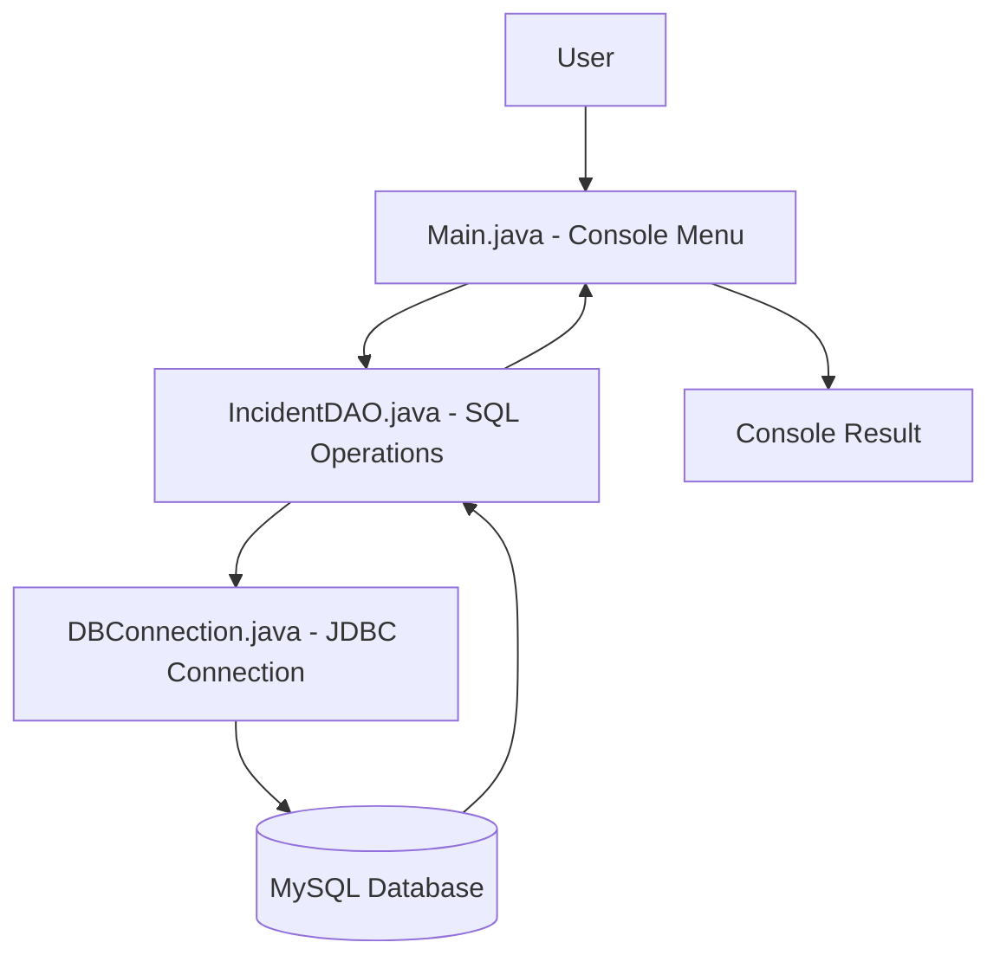

# 🛡️ Cybersecurity Incident Management System

```{=html}
<p align="center">
```
`<strong>`{=html}A Java console-based application to report, track, and
manage cybersecurity incidents.`</strong>`{=html} `<br />`{=html} Built
with Java, MySQL, and JDBC.
```{=html}
</p>
```
```{=html}
<p align="center">
```
``{=html}
``{=html}
``{=html}
``{=html}
```{=html}
</p>
```
```{=html}
<p align="center">
```
``{=html}
```{=html}
</p>
```

------------------------------------------------------------------------

## 📌 Table of Contents

-   [Overview](#-overview)
-   [Features](#-features)
-   [How It Works](#-how-it-works)
-   [OOP Concepts](#-oop-concepts)
-   [Project Structure](#-project-structure)
-   [Requirements](#-requirements)
-   [Installation and Setup](#-installation-and-setup)
-   [Run the Application](#-run-the-application)
-   [Sample Data](#-sample-data)
-   [Troubleshooting](#-troubleshooting)
-   [Security Notes](#-security-notes)
-   [Future Improvements](#-future-improvements)

## 📖 Overview

The **Cybersecurity Incident Management System** is a menu-driven Java
application that helps users record and manage cybersecurity incidents.
It connects to a MySQL database through JDBC, so incident records remain
available even after the application is closed.

The project demonstrates core Java OOP concepts, database connectivity,
and basic CRUD (Create, Read, Update, Delete) operations.

## ✨ Features

  -----------------------------------------------------------------------
  Feature                             Description
  ----------------------------------- -----------------------------------
  📝 Report an incident               Create a new incident with its
                                      description and severity.

  📋 View all incidents               Display the incidents stored in the
                                      database.

  🔎 Search by severity               Find incidents by severity level.

  🔄 Update status                    Change an incident's current
                                      status.

  👤 Assign an analyst                Assign an available analyst to an
                                      incident.

  🗑️ Delete an incident               Remove an incident record.

  👥 View analysts                    Display the available security
                                      analysts.

  💾 Persistent storage               Store data in MySQL so it remains
                                      after the program exits.
  -----------------------------------------------------------------------

## 🔄 How It Works

1.  The user selects an operation from the Java console menu.
2.  `Main` collects the required input.
3.  `IncidentDAO` executes the corresponding SQL operation using JDBC.
4.  MySQL stores or retrieves the incident data.
5.  The result is displayed in the console.



## 🧠 OOP Concepts

-   **Encapsulation:** Incident data fields are private and accessed
    through getters.
-   **Classes and objects:** The project uses `Main`, `Incident`,
    `IncidentDAO`, and `DBConnection`.
-   **Separation of responsibilities:**
    -   `Incident` represents incident data.
    -   `IncidentDAO` handles database operations.
    -   `DBConnection` manages the JDBC connection.
    -   `Main` handles console input and output.
-   **Abstraction and reusability:** DAO methods provide reusable
    operations while keeping SQL logic separate from the console
    interface.

## 📁 Project Structure

``` text
CybersecurityIncidentManagementSystem/
│
├── Main.java
├── Incident.java
├── IncidentDAO.java
├── DBConnection.java
├── schema.sql
├── mysql-connector-j.jar
├── README.md
└── assets/
    └── cybersecurity-incident-management.png
```

> Keep the actual MySQL Connector/J JAR in your local project folder. Do
> not commit the JAR unless you intentionally want to include the
> dependency in your repository.

## 🧰 Requirements

Make sure you have the following installed:

1.  **JDK 8 or newer**
2.  **MySQL Server**
3.  **MySQL Workbench** or MySQL Command Line Client
4.  **MySQL Connector/J** JDBC driver

## ⚙️ Installation and Setup

```{=html}
<details>
```
```{=html}
<summary>
```
`<strong>`{=html}Step 1 --- Clone the repository`</strong>`{=html}
```{=html}
</summary>
```
``` bash
git clone https://github.com/YOUR_USERNAME/CybersecurityIncidentManagementSystem.git
cd CybersecurityIncidentManagementSystem
```

Replace `YOUR_USERNAME` with your GitHub username and use your actual
repository URL.

```{=html}
</details>
```
```{=html}
<details>
```
```{=html}
<summary>
```
`<strong>`{=html}Step 2 --- Create the database`</strong>`{=html}
```{=html}
</summary>
```
Open `schema.sql` in MySQL Workbench and execute the complete script.

Or run this command from the project folder:

``` bash
mysql -u root -p < schema.sql
```

```{=html}
</details>
```
```{=html}
<details>
```
```{=html}
<summary>
```
`<strong>`{=html}Step 3 --- Configure the database
connection`</strong>`{=html}
```{=html}
</summary>
```
Open `DBConnection.java`.

Set the database username and password to match your local MySQL
configuration. If your MySQL username is not `root`, update the username
too.

Also verify that the JDBC URL uses the correct database name and port.
The default MySQL port is usually `3306`.

**Important:** Never commit your real database password to GitHub. Keep
local credentials out of version control. For a stronger setup, read
credentials from environment variables rather than hardcoding them.

```{=html}
</details>
```
```{=html}
<details>
```
```{=html}
<summary>
```
`<strong>`{=html}Step 4 --- Download MySQL Connector/J`</strong>`{=html}
```{=html}
</summary>
```
1.  Visit the [official MySQL Connector/J download
    page](https://dev.mysql.com/downloads/connector/j/).
2.  Download and extract the archive.
3.  Find the Connector/J `.jar` file.
4.  Copy the actual JAR into the project folder.
5.  Rename the copied file to `mysql-connector-j.jar`.

Do not create an empty JAR file. Use the driver JAR from the downloaded
archive.

```{=html}
</details>
```
## ▶️ Run the Application

Open **Command Prompt (CMD)** in the project folder.

```{=html}
<details>
```
```{=html}
<summary>
```
`<strong>`{=html}Step 5 --- Compile (Windows CMD)`</strong>`{=html}
```{=html}
</summary>
```
``` bat
javac -cp ".;mysql-connector-j.jar" Main.java DBConnection.java Incident.java IncidentDAO.java
```

```{=html}
</details>
```
```{=html}
<details>
```
```{=html}
<summary>
```
`<strong>`{=html}Step 6 --- Run (Windows CMD)`</strong>`{=html}
```{=html}
</summary>
```
``` bat
java -cp ".;mysql-connector-j.jar" Main
```

```{=html}
</details>
```
**macOS / Linux:** Replace the semicolon (`;`) in the classpath with a
colon (`:`).

``` bash
javac -cp ".:mysql-connector-j.jar" Main.java DBConnection.java Incident.java IncidentDAO.java
java -cp ".:mysql-connector-j.jar" Main
```

## 🧪 Sample Data

### Analysts

    No. Analyst       Specialization
  ----- ------------- -------------------
      1 Asha Nair     Network Security
      2 Rahul Menon   Malware Analysis
      3 Meera Das     Incident Response

### Example incidents

  Incident                    Severity   Status
  --------------------------- ---------- -------------
  Suspicious login attempts   MEDIUM     OPEN
  Unusual endpoint activity   HIGH       IN_PROGRESS

*These are sample records. The actual records depend on the data
inserted into your MySQL database.*

## 🛠️ Troubleshooting

```{=html}
<details>
```
```{=html}
<summary>
```
`<strong>`{=html}Access denied for user`</strong>`{=html}
```{=html}
</summary>
```
Check the MySQL username and password configured in `DBConnection.java`.
Confirm that the MySQL user has permission to access the project
database.

```{=html}
</details>
```
```{=html}
<details>
```
```{=html}
<summary>
```
`<strong>`{=html}Unknown database`</strong>`{=html}
```{=html}
</summary>
```
Run `schema.sql` in MySQL Workbench or execute:

``` bash
mysql -u root -p < schema.sql
```

```{=html}
</details>
```
```{=html}
<details>
```
```{=html}
<summary>
```
`<strong>`{=html}Communications link failure`</strong>`{=html}
```{=html}
</summary>
```
Make sure the MySQL Server service is running. Also verify the host and
port in the JDBC URL.

```{=html}
</details>
```
```{=html}
<details>
```
```{=html}
<summary>
```
`<strong>`{=html}No suitable driver`</strong>`{=html}
```{=html}
</summary>
```
Confirm that `mysql-connector-j.jar` exists in the project folder and
that the classpath uses the exact same filename.

```{=html}
</details>
```
```{=html}
<details>
```
```{=html}
<summary>
```
`<strong>`{=html}'javac' is not recognized`</strong>`{=html}
```{=html}
</summary>
```
Install a JDK and configure the JDK `bin` directory in your system
`PATH`. Reopen CMD after updating the environment variable.

```{=html}
</details>
```
```{=html}
<details>
```
```{=html}
<summary>
```
`<strong>`{=html}MySQL uses a different port`</strong>`{=html}
```{=html}
</summary>
```
Update the port in the JDBC URL inside `DBConnection.java` to match your
MySQL Server configuration.

```{=html}
</details>
```
## 🔐 Security Notes

This project is intended for learning and demonstration purposes. Before
using it in a real environment:

-   Use prepared statements for all SQL queries to help prevent SQL
    injection.
-   Do not hardcode database passwords or commit credentials to GitHub.
-   Use a dedicated MySQL account with only the permissions the
    application needs; avoid using the root account.
-   Validate user input before storing or processing it.
-   Add authentication and role-based authorization before allowing
    users to manage sensitive incidents.
-   Handle database errors safely and avoid displaying credentials or
    sensitive system details.

## 🚀 Future Improvements

-   Add analyst login and role-based access control.
-   Add incident timestamps and audit logs.
-   Add filters for status, date, and assigned analyst.
-   Export incident reports to CSV or PDF.
-   Build a web-based dashboard.
-   Add unit tests and automated database integration tests.

------------------------------------------------------------------------

```{=html}
<p align="center">
```
`<strong>`{=html}⭐ If you find this project useful, consider giving the
repository a star!`</strong>`{=html} `<br />`{=html} Built with Java ☕,
MySQL 🐬, and JDBC
```{=html}
</p>
```
